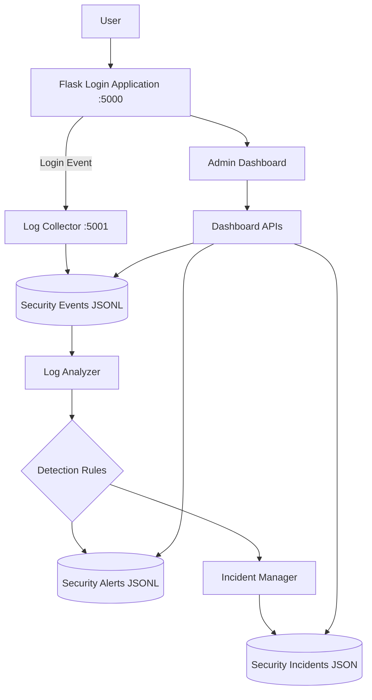

# Cloud Security Monitoring System

A Python Flask-based local security monitoring and incident management lab.

## Architecture Diagram



## Features

- Role-based demo login
- Login success and failure event collection
- Centralized security event logging
- Brute-force login detection
- Successful login after multiple failures detection
- Alert generation and duplicate suppression
- Incident creation and management
- Investigation notes and response actions
- Admin-only monitoring dashboard
- Flask session security settings
- CSRF protection implemented; full verification pending

## Detection Rules

| Detection | Threshold | Severity |
|---|---|---|
| Brute-force login | 5 or more failures within 5 minutes | High |
| Successful login after failures | 5 or more failures within 10 minutes followed by success | Medium |

## Technology Stack

- Python
- Flask
- Flask-WTF
- Requests
- JSON / JSONL
- HTML, CSS and JavaScript

## Local Setup

Create and activate a virtual environment:

```powershell
python -m venv .venv
Set-ExecutionPolicy -Scope Process -ExecutionPolicy Bypass
.\.venv\Scripts\Activate.ps1
```

Install dependencies:

```powershell
pip install -r requirements.txt
```

Prepare the Flask secret key:

```powershell
python -c "from pathlib import Path; import secrets; p=Path('data'); p.mkdir(exist_ok=True); f=p/'flask_secret.key'; f.exists() or f.write_text(secrets.token_hex(32), encoding='utf-8'); print('Secret key ready')"
```

## Run the Lab

Use three separate PowerShell terminals.

**Terminal 1 — Collector**

```powershell
python collector\collector.py
```

**Terminal 2 — Main Application**

```powershell
python app.py
```

**Terminal 3 — Analyzer**

```powershell
python -m analyzer.analyzer
```

Open the dashboard:

`http://127.0.0.1:5000`

## Security Notes

- Flask secret key is stored locally and excluded from Git.
- Runtime logs and incident data are excluded from Git.
- Demo credentials must be replaced before public or production use.
- Secure cookies require HTTPS in production.
- This is an educational local prototype, not a production-ready SIEM.
- CSRF protection is implemented, but complete positive and negative verification is pending.

## Project Status

Local monitoring, detection and incident management features have been implemented and exercised.

Full CSRF verification and the planned Azure monitoring lab remain pending.